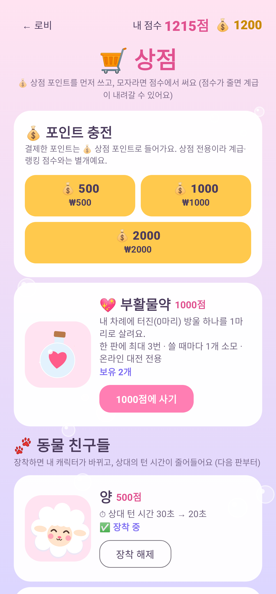

# Bubble 냥햄대전 🐱🫧🐹

고양이와 햄스터가 비눗방울 속에서 겨루는 2인 턴제 안드로이드 게임입니다.
앱을 켜면 대기방(로비)이 나오고, **랜덤 매칭**으로 익명의 상대와 1:1 대결을 합니다. 이기면 점수가 올라가요.

| 로비 | 상점 | 게임 |
|---|---|---|
|  |  |  |

## 게임 규칙

- 고양이와 햄스터가 각자 방울(세트) 2개에 1마리씩 들고 시작합니다. 고양이가 먼저 둡니다.
- 내 차례에는 살아있는 내 방울 하나를 고르고, 그 방울의 마리 수만큼
  - ⚔️ **공격**: 상대의 살아있는 방울에 더하거나
  - 💪 **강화**: 내 다른 살아있는 방울에 더합니다.
- 방울이 **5마리 이상**이 되면 💥 펑 터져서 0마리가 됩니다.
- 0마리 방울은 공격도 강화도 할 수 없습니다. 살리는 방법은 **분할**뿐입니다.
  - ✂️ 한 방울이 짝수(2·4마리)이고 다른 방울이 0일 때 반씩 나눕니다 (4·0 → 2·2, 2·0 → 1·1).
  - 분할은 한 게임에 한 사람당 **최대 3번**. 화면에 남은 횟수(✂️ ●●● 3/3)가 보이고, 쓰면 -1이 떠오릅니다.
- 내 방울 2개가 모두 0이 되면 집니다.
- 온라인 대전은 한 턴 30초. 시간을 넘기거나 나가면 패배합니다.
- 점수: 처음 1000점, 승리 +25점, 패배 -15점.

## 계급

| 점수 | 계급 | 배지 효과 |
|---|---|---|
| 1000점 이하 | 🟫 흙 | 없음 |
| 1001~1100 | 🥉 구리 | 반짝이 2개 |
| 1101~1200 | 🥈 은 | 반짝이 + 빛 줄기 |
| 1201~1300 | 🥇 금 | 반짝이 많이 + 빛 줄기 + 은은한 광채 |
| 1301 이상 | 💎 다이아 | 무지개로 변하는 배지 + 무지개 반짝이 + 광채 |

계급이 오르면 승급 축하 화면이 나오고, 높은 계급일수록 반짝이가 더 많이, 크게 터집니다.

## AI 대전 점수

로그인한 상태의 AI 대전은 서버에서 진행되고(AI의 수도 서버가 둠) 점수가 걸립니다. 승패 기록에는 들어가지 않습니다.

| 난이도 | 승리 | 패배 |
|---|---|---|
| 쉬움 | +1 | 0 |
| 보통 | +5 | -3 |
| 어려움 | +10 | -5 |

로그인하지 않았으면 폰 안에서 점수 없이 연습합니다.

## 상점 (점수로 구매)

| 상품 | 가격 | 효과 |
|---|---|---|
| 💖 부활물약 | 1000점 | 내 차례에 터진 방울 하나를 1마리로 살림. 한 판 최대 3번, 쓸 때마다 1개 소모 (온라인 전용) |
| 🐑 양 | 500점 | 장착하면 상대 턴 시간 30초 → 20초 |
| 🐶 강아지 | 750점 | 상대 턴 시간 → 15초 |
| 🦒 기린 | 1000점 | 상대 턴 시간 → 10초 |

구매·장착·물약 사용은 모두 서버(Cloud Functions)가 점수와 보유 여부를 검사합니다.

## 기능

- 구글 로그인: 점수·전적이 구글 계정에 저장 (상대에게는 닉네임만 보임)
- 로비: 닉네임(자동 생성, 변경 가능), 점수·전적, 랭킹 TOP 30, 로그아웃
- 랜덤 매칭: Firestore 대기열로 익명 상대와 자동 연결
- 온라인 대전: 실시간 동기화, 턴 타이머, 기권/시간초과 처리
- AI 연습: 쉬움 / 보통 / 어려움 (미니맥스 AI, 오프라인)
- 애니메이션: 숨쉬는 방울, 깜빡이는 캐릭터, 4마리 위험 떨림, 펑 터지는 파티클

## 기술

Kotlin · Jetpack Compose · Firebase (Google 로그인 + Cloud Firestore + Cloud Functions) · Credential Manager

```
app/src/main/java/com/bubble/game/
  game/GameLogic.kt        규칙 엔진 (순수 Kotlin, 단위 테스트 있음)
  game/Ai.kt               AI 상대
  data/OnlineRepository.kt 로그인 · 매칭 · 대전 · 점수 (Firestore)
  ui/                      화면, 캐릭터 그림, 방울 애니메이션
functions/src/index.ts     서버: 매칭 · 수 검증 · 승패 · 점수 (Cloud Functions)
functions/src/game.ts      서버용 규칙 엔진 (앱과 같은 규칙)
firestore.rules            Firestore 보안 규칙 (점수·게임은 서버만 쓰기)
```

### 점수 조작 방지

앱은 게임 판과 점수를 직접 쓸 수 없습니다. 매칭, 수 두기, 승패 판정, 점수 계산은 모두 Cloud Functions가
서버에서 검증하고 기록하며, 앱은 Firestore에서 결과를 읽기만 합니다.
- `matchmake` / `leaveQueue`: 랜덤 매칭
- `submitMove`: 차례·규칙 검증 후 판 갱신, 끝나면 두 사람 점수 반영
- `forfeit`: 기권
- `claimTimeout`: 상대가 30초(+5초 여유)를 넘기면 승리 (서버 시계 기준)

## 서버 배포 (Cloud Functions + 보안 규칙)

Cloud Functions는 Firebase **Blaze(종량제) 요금제**가 필요합니다. 무료 사용량(월 호출 200만 회 등)이 넉넉해서
작은 게임은 보통 요금이 나오지 않지만, 결제 카드 등록이 필요하고 예산 알림을 걸어두는 것을 권장합니다.

1. Firebase 콘솔 → 왼쪽 아래 **업그레이드** → Blaze 선택 (Google Cloud 콘솔에서 예산 알림 설정 권장)
2. 컴퓨터에 [Node.js 22](https://nodejs.org)를 설치하고, 이 저장소 폴더에서:

```bash
npm install -g firebase-tools
firebase login
cd functions && npm install && cd ..
firebase deploy --only functions,firestore:rules
```

배포가 끝나야 새 앱(1.1.0)에서 매칭과 대전이 동작합니다. 1.0.0 앱은 서버 배포 후 게임 판을 직접 쓰지 못해 더 이상 대전할 수 없습니다.

## 온라인 대전 켜기 (Firebase 설정)

`google-services.json`이 없어도 앱은 빌드되고 AI 연습 모드로 동작합니다. 온라인 대전을 켜려면:

1. [Firebase 콘솔](https://console.firebase.google.com)에서 프로젝트를 만듭니다.
2. **Android 앱 추가** → 패키지 이름 `com.bubble.game` → `google-services.json`을 내려받아 `app/` 폴더에 넣습니다.
3. **Authentication → 로그인 방법 → Google** 을 사용 설정합니다.
   그리고 프로젝트 설정 → 내 앱 → **디지털 지문 추가**에 서명 키의 SHA-1을 등록한 뒤, `google-services.json`을 다시 내려받습니다.
4. **Firestore Database** 를 만들고, **규칙** 탭에 이 저장소의 `firestore.rules` 내용을 붙여넣고 게시합니다.
5. 다시 빌드합니다.

## 서명 키 (구글 로그인에 필요)

구글 로그인은 Firebase에 등록한 SHA-1과 같은 키로 서명한 APK에서만 동작합니다.
`keystore/bubble.jks`가 있고 비밀번호가 `local.properties`의 `bubbleKeystorePassword`(또는 환경변수 `BUBBLE_KEYSTORE_PASSWORD`)에 있으면 그 키로 서명합니다.
키와 비밀번호는 저장소에 올리지 않습니다. 잃어버리면 같은 키로 다시 서명할 수 없으니 안전한 곳에 보관하세요.

## 정식 릴리스 빌드

- 릴리스 빌드는 R8로 코드 축소·난독화와 리소스 축소를 합니다.
- `./gradlew bundleRelease` → `app/build/outputs/bundle/release/app-release.aab` (Play 스토어 업로드용)
- `./gradlew assembleRelease` → `app/build/outputs/apk/release/app-release.apk` (직접 배포용)
- 새 버전을 낼 때마다 `app/build.gradle.kts`의 `versionCode`(1씩 증가)와 `versionName`을 올리세요.
- Play 스토어에 올릴 때 **Play 앱 서명**을 쓰면 Google이 최종 서명을 다시 합니다. 그 경우 Play Console → 앱 무결성에 나오는
  **앱 서명 키 SHA-1**도 Firebase에 지문으로 추가해야 스토어에서 받은 앱의 구글 로그인이 동작합니다.

## APK 받기 / 빌드

- **GitHub Actions**: `main`에 푸시할 때마다 APK가 빌드됩니다. 저장소의 Actions 탭 → 최근 실행 → `bubble-debug-apk`를 내려받아 폰에 설치하세요.
  온라인 대전이 켜진 APK를 원하면 저장소 Settings → Secrets and variables → Actions에 다음을 추가하세요.
  - `GOOGLE_SERVICES_JSON`: 파일 내용 그대로
  - `BUBBLE_KEYSTORE_BASE64`: `keystore/bubble.jks`를 base64로 인코딩한 값
  - `BUBBLE_KEYSTORE_PASSWORD`: 서명 키 비밀번호
- **직접 빌드**: Android Studio로 열어서 실행하거나 `./gradlew assembleDebug`.
