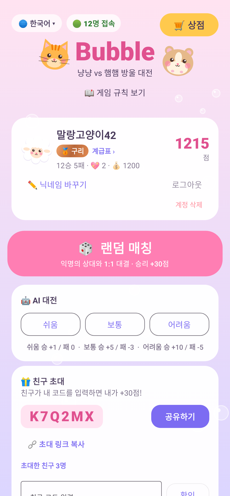
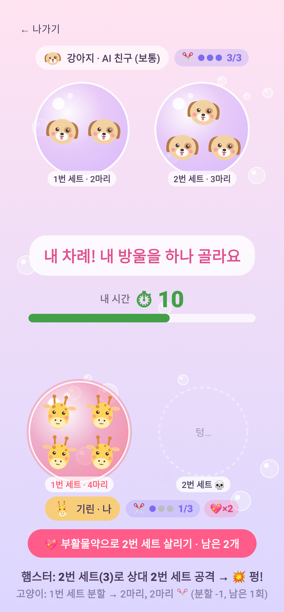

# Bubble 냥햄대전 🐱🫧🐹

고양이와 햄스터가 비눗방울 속에서 겨루는 2인 턴제 안드로이드 게임입니다.
앱을 켜면 대기방(로비)이 나오고, **랜덤 매칭**으로 익명의 상대와 1:1 대결을 합니다. 이기면 점수가 올라가요.

| 로비 | 상점 | 게임 |
|---|---|---|
|  |  |  |

## 게임 규칙

- 고양이와 햄스터가 각자 방울(세트) 2개에 1마리씩 들고 시작합니다. 고양이가 먼저 둡니다.
- 내 차례에는 살아있는 내 방울 하나를 고르고, 그 방울의 마리 수만큼
  - ⚔️ **공격**: 상대의 살아있는 방울에 더하거나
  - 💪 **강화**: 내 다른 살아있는 방울에 더합니다.
- 방울이 **5마리 이상**이 되면 💥 펑 터져서 0마리가 됩니다.
- 0마리 방울은 공격도 강화도 할 수 없습니다. 살리는 방법은 **분할**뿐입니다.
  - ✂️ 한 방울이 짝수(2·4마리)이고 다른 방울이 0일 때 반씩 나눕니다 (4·0 → 2·2, 2·0 → 1·1).
  - 분할은 한 게임에 한 사람당 **최대 3번**. 화면에 남은 횟수(✂️ ●●● 3/3)가 보이고, 쓰면 -1이 떠오릅니다.
- 내 방울 2개가 모두 0이 되면 집니다.
- 온라인 대전은 한 턴 **20초**(상대가 동물을 쓰면 15·10·5초). 시간을 넘기거나 나가면 패배합니다.
- 점수: 처음 1000점, 랜덤 매칭 승리 +30점(+계급 보너스), 패배 -15점.

## 계급

| 점수 | 계급 | 승리 보너스 | 배지 효과 |
|---|---|---|---|
| 1000 이하 | 🟫 흙 | 0% | 없음 |
| 1001~1499 | 🥉 구리 | +5% | 반짝이 2개 |
| 1500~1999 | 🥈 은 | +10% | 반짝이 4개 + 빛 줄기 |
| 2000~4999 | 🥇 금 | +15% | 반짝이 6개 + 빛 줄기 + 광채 |
| 5000~6999 | 🔴 루비 | +20% | 붉은 반짝이 8개 + 더 큰 광채 |
| 7000~9999 | 🔷 사파이어 | +25% | 푸른 반짝이 11개 + 더 큰 광채 |
| 10000 이상 | 💎 다이아 | +30% | 무지개로 흐르는 배지 + 무지개 반짝이 16개 + 가장 큰 광채 |

승급하면 축하 화면이 나오고, 높은 계급일수록 반짝이가 더 많이, 크게 터집니다.

## 가입과 계정

- 첫 로그인 시 서버가 프로필을 만들고 환영 팝업을 띄웁니다. 시작 점수: 보통 **1000점**, 탈퇴 후 같은 구글 계정으로 재가입 **0점**, 관리자 계정 **5000점**.
- 관리자 계정(`functions/src/index.ts`의 `ADMIN_EMAILS`)은 로비 위쪽에 **동시 접속자 수**(최근 2분 안에 접속 신호를 보낸 사용자)가 보입니다.

## AI 대전 점수

로그인한 상태의 AI 대전은 서버에서 진행되고(AI의 수도 서버가 둠) 점수가 걸립니다. 승패 기록에는 들어가지 않습니다.

| 난이도 | 승리 | 패배 | 내 턴 시간 |
|---|---|---|---|
| 쉬움 | +1 | 0 | 20초 |
| 보통 | +5 | -3 | 15초 |
| 어려움 | +10 | -5 | 5초 |

시간 안에 못 두면 패배 (서버가 서버 시계로 판정, 늦게 도착한 수는 거절). 게임 화면에는 남은 시간이 큰 숫자와 줄어드는 게이지로 보이고, 마지막 5초는 빨갛게 깜빡입니다.

로그인하지 않았으면 폰 안에서 점수 없이 연습합니다.

## 상점 (점수로 구매)

| 상품 | 가격 | 효과 |
|---|---|---|
| 💖 부활물약 | 50점 | 내 차례에 터진 방울 하나를 1마리로 살림. 한 판 최대 3번, 쓸 때마다 1개 소모 (온라인 전용) |
| ×3 점수 부스터 | 50점 | 소모품 · 켜두면 다음 랜덤 매칭 시작 때 1개 사용, 이기면 얻는 점수(계급 보너스 포함) 3배 (AI 대전에는 안 씀) |
| 🐑 양 | 30점 | 소모품 · 그 판의 상대 턴 시간 20초 → 15초 |
| 🐶 강아지 | 50점 | 소모품 · 상대 턴 시간 → 10초 |
| 🦒 기린 | 100점 | 소모품 · 상대 턴 시간 → 5초 |

동물은 **소모품**입니다. 장착한 채 랜덤 매칭이 잡히면 1개를 쓰고 그 판에만 캐릭터와 효과가 적용되며, 다 쓰면 기본 캐릭터로 돌아갑니다 (AI 대전에서는 쓰지 않음).

구매·장착·물약 사용은 모두 서버(Cloud Functions)가 점수와 보유 여부를 검사합니다.

## 기능

- 구글 로그인: 점수·전적이 구글 계정에 저장 (상대에게는 닉네임만 보임)
- 로비: 닉네임(자동 생성, 변경 가능), 점수·전적, 랭킹 TOP 30, 로그아웃
- 랜덤 매칭: 비슷한 점수끼리 먼저 연결 (처음 ±1000점, 1초마다 1000점씩 범위 확대), **20초가 지나면 점수와 상관없이 아무나**, **30초가 지나도 상대가 없으면 AI(어려움)와 대결** (AI라고 표시)
- 매칭되면 VS 소개 화면에 서로의 **국기·나라·계급**이 3초 동안 보이고, 게임 중 이름표에도 국기와 계급 배지가 표시됨 (나라는 통신사/SIM 국가 기준, 위치 권한 없음)
- 온라인 대전: 실시간 동기화, 턴 타이머, 기권/시간초과 처리
- AI 연습: 쉬움 / 보통 / 어려움 (미니맥스 AI, 오프라인)
- 애니메이션: 숨쉬는 방울, 깜빡이는 캐릭터, 4마리 위험 떨림, 펑 터지는 파티클

## 기술

Kotlin · Jetpack Compose · Firebase (Google 로그인 + Cloud Firestore + Cloud Functions) · Credential Manager

```
app/src/main/java/com/bubble/game/
  game/GameLogic.kt        규칙 엔진 (순수 Kotlin, 단위 테스트 있음)
  game/Ai.kt               AI 상대
  data/OnlineRepository.kt 로그인 · 매칭 · 대전 · 점수 (Firestore)
  ui/                      화면, 캐릭터 그림, 방울 애니메이션
functions/src/index.ts     서버: 매칭 · 수 검증 · 승패 · 점수 (Cloud Functions)
functions/src/game.ts      서버용 규칙 엔진 (앱과 같은 규칙)
firestore.rules            Firestore 보안 규칙 (점수·게임은 서버만 쓰기)
```

### 점수 조작 방지

앱은 게임 판과 점수를 직접 쓸 수 없습니다. 매칭, 수 두기, 승패 판정, 점수 계산은 모두 Cloud Functions가
서버에서 검증하고 기록하며, 앱은 Firestore에서 결과를 읽기만 합니다.
- `matchmake` / `leaveQueue`: 랜덤 매칭
- `submitMove`: 차례·규칙 검증 후 판 갱신, 끝나면 두 사람 점수 반영
- `forfeit`: 기권
- `claimTimeout`: 상대가 30초(+5초 여유)를 넘기면 승리 (서버 시계 기준)

## 서버 배포 (Cloud Functions + 보안 규칙)

Cloud Functions는 Firebase **Blaze(종량제) 요금제**가 필요합니다. 무료 사용량(월 호출 200만 회 등)이 넉넉해서
작은 게임은 보통 요금이 나오지 않지만, 결제 카드 등록이 필요하고 예산 알림을 걸어두는 것을 권장합니다.

1. Firebase 콘솔 → 왼쪽 아래 **업그레이드** → Blaze 선택 (Google Cloud 콘솔에서 예산 알림 설정 권장)
2. 컴퓨터에 [Node.js 22](https://nodejs.org)를 설치하고, 이 저장소 폴더에서:

```bash
npm install -g firebase-tools
firebase login
cd functions && npm install && cd ..
firebase deploy --only functions,firestore:rules
```

배포가 끝나야 새 앱(1.1.0)에서 매칭과 대전이 동작합니다. 1.0.0 앱은 서버 배포 후 게임 판을 직접 쓰지 못해 더 이상 대전할 수 없습니다.

## 온라인 대전 켜기 (Firebase 설정)

`google-services.json`이 없어도 앱은 빌드되고 AI 연습 모드로 동작합니다. 온라인 대전을 켜려면:

1. [Firebase 콘솔](https://console.firebase.google.com)에서 프로젝트를 만듭니다.
2. **Android 앱 추가** → 패키지 이름 `com.bubble.game` → `google-services.json`을 내려받아 `app/` 폴더에 넣습니다.
3. **Authentication → 로그인 방법 → Google** 을 사용 설정합니다.
   그리고 프로젝트 설정 → 내 앱 → **디지털 지문 추가**에 서명 키의 SHA-1을 등록한 뒤, `google-services.json`을 다시 내려받습니다.
4. **Firestore Database** 를 만들고, **규칙** 탭에 이 저장소의 `firestore.rules` 내용을 붙여넣고 게시합니다.
5. 다시 빌드합니다.

## 서명 키 (구글 로그인에 필요)

구글 로그인은 Firebase에 등록한 SHA-1과 같은 키로 서명한 APK에서만 동작합니다.
`keystore/bubble.jks`가 있고 비밀번호가 `local.properties`의 `bubbleKeystorePassword`(또는 환경변수 `BUBBLE_KEYSTORE_PASSWORD`)에 있으면 그 키로 서명합니다.
키와 비밀번호는 저장소에 올리지 않습니다. 잃어버리면 같은 키로 다시 서명할 수 없으니 안전한 곳에 보관하세요.

## 친구 추천

- 로비의 **친구 초대**에서 내 6자리 코드나 **초대 링크**를 공유하고, 친구가 그 코드를 입력하면 **초대한 사람에게 +30점**.
- 초대 링크: `https://softrime0-77.github.io/Bubble/invite.html?code=ABC234` → 초대 페이지에서 "앱에서 열기" / "Google Play에서 받기" / "APK 받기".
  앱을 이 링크로 열거나 Play 스토어 링크로 설치하면(Install Referrer) 로그인 후 코드가 **자동으로 입력**됩니다.
- 코드 입력은 계정당 1번, 자기 코드 불가, 초대 보상은 1인당 최대 100명까지 (서버 `redeemReferral`).

## 인앱 결제 (500점 ₩500 · 1000점 ₩1000 · 2000점 ₩2000)

상점 맨 위 **포인트 충전**. 결제로 받은 포인트는 **💰 상점 포인트**(`coins`)로 따로 쌓여 **상점 전용**입니다 — 계급·랭킹 점수(`score`)에는 들어가지 않습니다.
상점에서 살 때는 상점 포인트를 먼저 쓰고, 모자라면 점수에서 나머지를 씁니다.
 Google Play 결제 → 서버(`verifyPurchase`)가 Google Play Developer API로 영수증을 확인한 뒤에만 점수 지급, 같은 영수증은 한 번만 인정.

설정 (한 번만):
1. Play Console → **수익 창출 설정**에서 판매자(결제) 프로필을 만듭니다.
2. 결제 라이브러리가 들어간 AAB(v1.10.0 이상)를 테스트 트랙에 올립니다.
3. Play Console → **수익 창출 → 제품 → 인앱 상품 → 상품 만들기**
   - 상품 4개를 만듭니다 (ID는 정확히 이 이름):
     | 상품 ID | 이름 예시 | 가격 |
     |---|---|---|
     | `points_500` | 포인트 500 | ₩500 |
     | `points_1000` | 포인트 1000 | ₩1,000 |
     | `points_2000` | 포인트 2000 | ₩2,000 |
   - 다른 나라 가격은 자동 환산 → 각각 **활성화**
4. [Google Cloud 콘솔](https://console.cloud.google.com/apis/library/androidpublisher.googleapis.com?project=bubble-422ef)에서 **Google Play Android Developer API** 사용 설정
5. Play Console → **사용자 및 권한 → 새 사용자 초대**
   - 이메일: `92307501556-compute@developer.gserviceaccount.com` (Cloud Functions 서버 계정)
   - 앱 권한: Bubble 선택, **재무 데이터 보기**, **주문 및 구독 관리** 체크
   - 권한이 적용되기까지 최대 하루 걸릴 수 있습니다.
6. 테스트: Play Console → 설정 → **라이선스 테스트**에 본인 구글 계정을 넣으면 실제 돈 없이 결제를 시험할 수 있습니다.

## 정식 릴리스 빌드

- 릴리스 빌드는 R8로 코드 축소·난독화와 리소스 축소를 합니다.
- `./gradlew bundleRelease` → `app/build/outputs/bundle/release/app-release.aab` (Play 스토어 업로드용)
- `./gradlew assembleRelease` → `app/build/outputs/apk/release/app-release.apk` (직접 배포용)
- 새 버전을 낼 때마다 `app/build.gradle.kts`의 `versionCode`(1씩 증가)와 `versionName`을 올리세요.
- Play 스토어에 올릴 때 **Play 앱 서명**을 쓰면 Google이 최종 서명을 다시 합니다. 그 경우 Play Console → 앱 무결성에 나오는
  **앱 서명 키 SHA-1**도 Firebase에 지문으로 추가해야 스토어에서 받은 앱의 구글 로그인이 동작합니다.

## APK 받기 / 빌드

- **GitHub Actions**: `main`에 푸시할 때마다 APK가 빌드됩니다. 저장소의 Actions 탭 → 최근 실행 → `bubble-debug-apk`를 내려받아 폰에 설치하세요.
  온라인 대전이 켜진 APK를 원하면 저장소 Settings → Secrets and variables → Actions에 다음을 추가하세요.
  - `GOOGLE_SERVICES_JSON`: 파일 내용 그대로
  - `BUBBLE_KEYSTORE_BASE64`: `keystore/bubble.jks`를 base64로 인코딩한 값
  - `BUBBLE_KEYSTORE_PASSWORD`: 서명 키 비밀번호
- **직접 빌드**: Android Studio로 열어서 실행하거나 `./gradlew assembleDebug`.

## iOS

`ios/` 폴더에 SwiftUI로 만든 아이폰 앱이 있습니다. 서버(Firebase)는 안드로이드와 같은 것을 써서 아이폰·안드로이드 사용자가 서로 매칭됩니다.

- `ios/BubbleCore`: 게임 규칙·AI·계급/상점 데이터 (Swift 패키지, 안드로이드·서버와 같은 규칙, 테스트 포함)
- `ios/Bubble`: SwiftUI 화면 (캐릭터·방울·타이머·11개 언어)
  - `Strings.swift`(고정 문장)와 `Templates.swift`(값이 들어가는 문장)는 안드로이드 번역에서 만든 표. `Templates.swift`는 `python3 ios/tools/gen_templates.py`로 다시 만듦
  - `Store.swift`: App Store 결제(StoreKit 2) · `Ads.swift`: AdMob + 광고 동의(UMP) · `AppleSignIn.swift`: Apple 로그인
- `ios/project.yml`: XcodeGen 설정 (`xcodegen generate`로 Xcode 프로젝트 생성)
- 빌드 확인: GitHub Actions **iOS** 워크플로(Mac)에서 테스트 → 시뮬레이터 빌드 → 스크린샷. 스크린샷은 `ios-screenshots` 브랜치에 올라감

진행 단계: ✅ 1단계 게임 화면·AI 연습 → ✅ 2단계 구글 로그인·온라인 대전 → ✅ 3단계 상점·결제·광고·친구 초대 → ✅ Apple 로그인·마무리 → TestFlight (Apple Developer 가입 후)

Firebase 설정은 저장소 Secrets의 `GOOGLE_SERVICE_INFO_PLIST`에서 CI가 넣습니다 (파일은 저장소에 올리지 않음).

### 아이폰 기능

- 로그인: **Apple로 계속하기** 또는 **Google로 시작하기**. 계정 삭제 시 Apple 계정은 Apple 토큰도 취소합니다 (App Store 규정)
- 상점: 💖 부활물약 · ×3 부스터 · 동물 친구들 (안드로이드와 같은 가격·규칙) + 💰 포인트 충전(App Store 결제)
- 게임: 부활물약 버튼, 부스터 표시, 패배 후 보상형 광고로 최대 8점 돌려받기
- 로비: 게임 규칙, 계급표, 닉네임 변경, 계정 삭제, 친구 초대(공유·링크 복사·코드 입력, `bubble://invite?code=…` 링크로 열면 자동 입력), 승급 축하 화면

### Apple Developer 가입 후 할 일 (한 번만)

1. **Apple 로그인 켜기**
   - [Apple Developer](https://developer.apple.com/account/resources/identifiers/list) → Identifiers → `com.bubble.game` → **Sign In with Apple** 체크
   - Firebase 콘솔 → Authentication → 로그인 방법 → **Apple** 사용 설정 (아이폰 앱만 쓰면 서비스 ID·키 입력 없이 저장해도 됨)
2. **결제 상품 만들기**: App Store Connect → 앱 → 인앱 구입 → **소모품** 3개 (ID는 정확히 이 이름)
   | 상품 ID | 포인트 | 가격 예 |
   |---|---|---|
   | `points_500` | 500 | ₩500 단계 |
   | `points_1000` | 1000 | ₩1,000 단계 |
   | `points_2000` | 2000 | ₩2,000 단계 |
   서버(`verifyApplePurchase`)는 Apple 서명을 직접 확인하므로 별도 API 키가 필요 없습니다. 테스트는 App Store Connect의 **샌드박스 테스터** 계정으로 합니다.
3. **광고**: AdMob에 iOS 앱을 추가하고, 전면 광고·보상형 전면 광고 단위를 만든 뒤
   - `ios/project.yml`의 `GADApplicationIdentifier`, `BubbleInterstitialId`, `BubbleRewardedId`를 실제 ID로 교체 (지금은 구글 테스트 광고)
   - 보상형 광고 단위의 **서버 측 확인** URL에 안드로이드와 같은 `admobSsv` 주소를 넣고, 단위 번호(`/` 뒤 숫자)를 `functions/src/index.ts`의 `REWARDED_AD_UNITS`에 추가
4. **서버 배포**: Apple 로그인·Apple 결제를 받도록 바뀐 서버와 보안 규칙을 배포
   ```bash
   firebase deploy --only functions,firestore:rules
   ```
5. TestFlight: 서명 인증서와 프로비저닝을 설정한 뒤 업로드 (다음 단계)
